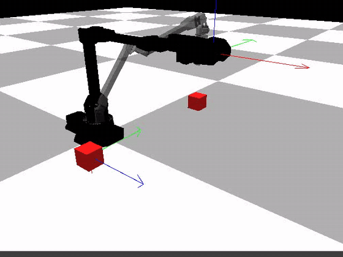
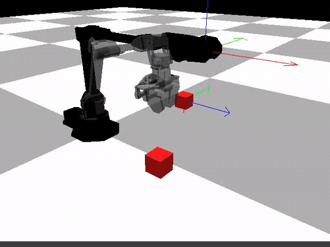
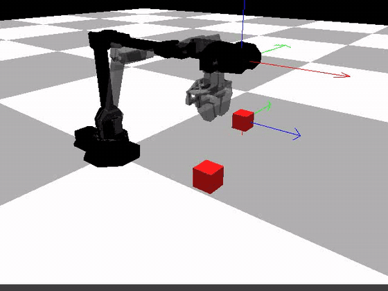
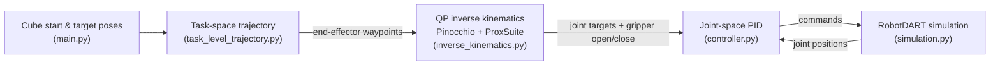

# VX300 5-DOF Robot Manipulation Simulation

A Python robotics project in which a simulated **Interbotix ViperX 300 (VX300) 5-DOF arm** picks up a cube and places it at a target pose.
The pipeline combines **task-space trajectory generation**, **QP-based inverse kinematics** (Pinocchio + ProxSuite) and **joint-space PID control**, all running inside the **RobotDART** simulator.

<p align="center">
  
  <br>
  <em>Example 0 — the cube is picked at (0.20, −0.20) m and placed at (0.20, 0.45) m.</em>
</p>

## Contents

- [Demo](#demo)
- [How it works](#how-it-works)
- [Libraries used](#libraries-used)
- [Setup (Ubuntu / WSL2)](#setup-ubuntu--wsl2)
- [Run the simulation](#run-the-simulation)
- [Troubleshooting](#troubleshooting)
- [Repository structure](#repository-structure)
- [Citations](#citations)
- [Authors](#authors) · [Acknowledgments](#acknowledgments) · [License](#license)

## Demo

| Example 0 | Example 2 | Example 3 |
|:---:|:---:|:---:|
|  |  |  |
| (0.20, −0.20) → (0.20, 0.45) | (0.20, 0.40) → (0.45, −0.10) | (0.30, 0.45) → (0.45, 0.00) |

**What you see:**

- **Black arm** — the simulated VX300 that is driven by the PID controller.
- **Gray arm** — a visual-only "ghost" robot that the IK solver uses to compute target joint angles.
- **Red cubes** — the real cube (with physics) and a visual-only cube that marks the target pose.
- **Colored arrows** — coordinate frames of the end effector and the cubes (red = x, green = y, blue = z).

The GIFs are played at 0.6× speed. They were recorded with RobotDART's built-in `Graphics.record_video()` and converted with `ffmpeg`.

## How it works



1. **Scene** (`simulation.py`) — creates the VX300 robot, the floor, the real cube and the visual target cube, sets the joint position limits, the graphics and the FCL collision detector.
2. **Trajectory** (`task_level_trajectory.py`) — builds a rectangular path in task space: above the cube → down to grasp → lift → move above the target → lower → release.
3. **Inverse kinematics** (`inverse_kinematics.py`) — for every waypoint, it iterates a small quadratic program until the pose error is below `1e-3`:

   $$
   \min_{v}\; \tfrac12\, v^\top (J^\top J)\, v \;-\; (J^\top e)^\top v
   \qquad \text{s.t.}\qquad q_{\min} - q_k \;\le\; \Delta t\, v \;\le\; q_{\max} - q_k ,
   \qquad q_{k+1} = q_k + \Delta t\, v
   $$

   where $J$ is the 6×5 end-effector Jacobian (from RobotDART), $e = \log_6\!\big(T_{wd}\, T_{wb}^{-1}\big)$ is the 6-D pose error (from Pinocchio's `pin.log6`), and the QP is solved with ProxSuite's dense **ProxQP** solver.
4. **Control** (`controller.py`, `main.py`) — a joint-space PID controller ($K_p = 250$, $K_i = 25$, $K_d = 2\sqrt{250}$) tracks each joint target, and the gripper is opened or closed at the grasp and release waypoints.

## Libraries used

| Library | What it does in this project | Version tested |
|---|---|---|
| [RobotDART](https://github.com/resibots/robot_dart) [[1]](#ref-robotdart) | Robot simulator: VX300 model, scene, simulation loop, Jacobians, graphics and video recording (`import RobotDART`). | `master` @ `8188beb` |
| [DART](https://dartsim.github.io/) [[2]](#ref-dart) | Physics engine under RobotDART (rigid-body dynamics and contacts); `dartpy` is its Python binding. | 6.13.2 |
| [FCL](https://github.com/flexible-collision-library/fcl) [[3]](#ref-fcl) | Collision detection between the gripper, the cube and the floor (`set_collision_detector("fcl")`). | via DART |
| [Magnum](https://magnum.graphics/) | Graphics engine that RobotDART uses to draw the 3-D window and record videos. | `master` (built by the RobotDART script) |
| [Pinocchio](https://github.com/stack-of-tasks/pinocchio) [[4]](#ref-pinocchio) | Rigid-body algorithms; here `pin.log6` gives the 6-D pose error between the current and the desired end-effector pose. | 4.1.0 |
| [ProxSuite (ProxQP)](https://github.com/Simple-Robotics/proxsuite) [[5]](#ref-proxqp) | Dense quadratic-programming solver used for the inverse kinematics. | 0.8.2 |
| [NumPy](https://numpy.org/) [[6]](#ref-numpy) | Arrays, matrices and linear algebra. | 2.3.5 |
| [Interbotix ViperX 300](https://docs.trossenrobotics.com/interbotix_xsarms_docs/specifications/vx300.html) | The robot arm that is simulated; its URDF ships with RobotDART (`rd.Vx300()`). | — |

## Setup (Ubuntu / WSL2)

> **Tested on:** Ubuntu 26.04 LTS on WSL2 (Windows 11), Python 3.14.
> The steps also work on native Ubuntu ≥ 22.04. If your Python is not 3.14, replace `3.14` / `py314` below with your version (check it with `python3 --version`).

### 1. Clone this repository

```bash
cd ~
git clone https://github.com/paog1/vx300-5dof-robot-simulation.git
```

### 2. Install RobotDART (with Magnum and the Python bindings)

RobotDART provides an install script ([quick install guide](https://nosalro.github.io/robot_dart/quick_install/)). It installs DART and the system packages, builds Magnum into `/opt/magnum`, and installs RobotDART into `/opt/robot_dart`.

```bash
cd ~
git clone https://github.com/resibots/robot_dart.git
cd robot_dart
```

The script compiles with many parallel jobs (`make -j`, `-j8`). On machines with limited RAM (for example a WSL2 instance with ~6 GB), the compiler can run out of memory and the script stops part-way. Limit it to 2 jobs first:

```bash
sed -i -E 's/(make|waf( examples)?) -j[0-9]*/\1 -j2/' scripts/install_ubuntu.sh
```

```bash
./scripts/install_ubuntu.sh
```

This builds several libraries from source, so it takes a while. It asks for your `sudo` password.

### 3. Install Pinocchio (robotpkg)

Pinocchio is installed from the [robotpkg](http://robotpkg.openrobots.org/) apt repository, as in the [Pinocchio installation guide](https://stack-of-tasks.github.io/pinocchio/download.html):

```bash
sudo apt install -qqy lsb-release curl
sudo mkdir -p /etc/apt/keyrings
curl http://robotpkg.openrobots.org/packages/debian/robotpkg.asc | sudo tee /etc/apt/keyrings/robotpkg.asc
echo "deb [arch=amd64 signed-by=/etc/apt/keyrings/robotpkg.asc] http://robotpkg.openrobots.org/packages/debian/pub $(lsb_release -cs) robotpkg" | sudo tee /etc/apt/sources.list.d/robotpkg.list
sudo apt update
sudo apt install -qqy robotpkg-py314-pinocchio
```

### 4. Set the environment variables

Add these lines to the end of `~/.bashrc`, then open a new terminal (or run `source ~/.bashrc`):

```bash
# RobotDART + Magnum + robotpkg (Pinocchio)
export PATH=/opt/magnum/bin:/opt/openrobots/bin:$PATH
export LD_LIBRARY_PATH=/opt/magnum/lib:/opt/robot_dart/lib:/opt/openrobots/lib:$LD_LIBRARY_PATH
export PYTHONPATH=/opt/robot_dart/lib/python3.14/site-packages:/opt/magnum/lib/python3/site-packages:/opt/openrobots/lib/python3.14/site-packages:$PYTHONPATH
export CMAKE_PREFIX_PATH=/opt/robot_dart:/opt/magnum:/opt/openrobots:$CMAKE_PREFIX_PATH
```

> The Magnum path is `python3/site-packages` (no minor version), while RobotDART and robotpkg use `python3.14/site-packages`.

### 5. Create the Python virtual environment

Ubuntu does not allow `pip install` into the system Python (`externally-managed-environment`), so use a virtual environment.
Create it with `--system-site-packages`, so that it can also see `dartpy`, which was installed by apt:

```bash
cd ~/vx300-5dof-robot-simulation
sudo apt install -y python3-venv python3-full
python3 -m venv --system-site-packages .venv
source .venv/bin/activate
pip install numpy proxsuite
```

> `requirements.txt` also lists `pin` (Pinocchio from PyPI). Skip it if you installed Pinocchio with robotpkg in step 3, so that you do not end up with two copies.

### 6. Check the installation

```bash
python -c "import RobotDART, dartpy, pinocchio, proxsuite, numpy; print('pinocchio', pinocchio.__version__, '| proxsuite', proxsuite.__version__)"
```

If this prints the two version numbers, everything is installed.

## Run the simulation

From the repository root, with the virtual environment active:

```bash
source .venv/bin/activate
python main.py
```

The program first solves the inverse kinematics for every waypoint. It prints one line per waypoint, for example `Found solution in 16193 iterations with error: [...]`. Then a RobotDART window opens and the arm moves the cube. The program prints `0` when it finishes.

### Choose an example

`main.py` contains six example tasks. Example 0 is active; to try another one, comment out the Example 0 lines and uncomment the example you want. Poses are `[roll, pitch, yaw, x, y, z]`; only `x, y` change between examples.

| Example | Cube start (x, y) [m] | Target (x, y) [m] |
|:---:|:---:|:---:|
| 0 | (0.20, −0.20) | (0.20, 0.45) |
| 1 | (0.30, 0.00) | (0.55, 0.00) |
| 2 | (0.20, 0.40) | (0.45, −0.10) |
| 3 | (0.30, 0.45) | (0.45, 0.00) |
| 4 | (0.20, 0.40) | (0.40, 0.40) |
| 5 | (0.20, 0.40) | (0.55, 0.00) |

In Examples 1, 3, 4 and 5, the IK stops for one or two waypoints slightly above the `1e-3` tolerance (`Could not find solution ...`). The cube is still transferred.

## Troubleshooting

| Message | Cause and fix |
|---|---|
| `error: externally-managed-environment` | `pip install` outside a virtual environment. Follow [step 5](#5-create-the-python-virtual-environment). |
| `ModuleNotFoundError: No module named 'RobotDART'` | RobotDART is not installed, or `PYTHONPATH` points to the wrong Python version. Check with `ls /opt/robot_dart/lib/python3.*/site-packages` and fix the version in `~/.bashrc` ([step 4](#4-set-the-environment-variables)). |
| `install_ubuntu.sh` stops while building `magnum-bindings` or RobotDART | The compiler ran out of memory. Apply the `-j2` change from [step 2](#2-install-robotdart-with-magnum-and-the-python-bindings) and run the script again; finished parts are reused. |
| `TypeError: init(): incompatible function arguments` (ProxSuite) | ProxSuite ≥ 0.8 accepts only 1-D vectors for `g`, `l`, `u`. This repository already flattens them; update `inverse_kinematics.py` if you use an older copy. |
| `libEGL warning: ...`, `MESA: error: ZINK: failed to choose pdev` | WSL2 cannot use the GPU for OpenGL and falls back to software rendering. The window still works; you can ignore these messages. |
| `[DARTCollisionDetector] Attempting to create shape type [MeshShape] ...` | Printed while the robots are added, before the simulation switches to the FCL collision detector. Harmless. |

## Repository structure

```text
vx300-5dof-robot-simulation/
├── main.py                    # Entry point: example poses, IK for each waypoint, PID loop
├── simulation.py              # RobotDART scene: robot, cubes, joint limits, graphics
├── task_level_trajectory.py   # Task-space waypoints (grasp → lift → move → place)
├── inverse_kinematics.py      # Forward kinematics + QP inverse kinematics (Pinocchio, ProxSuite)
├── controller.py              # Joint-space PID controller
├── media/                     # Demo GIFs used in this README
│   ├── example0.gif
│   ├── example2.gif
│   └── example3.gif
├── requirements.txt
├── LICENSE
└── README.md
```

## Citations

If you use this project, please also cite the libraries it is built on.

<a id="ref-robotdart"></a>**[1] RobotDART** — K. Chatzilygeroudis, T. Dionis, J.-B. Mouret, *RobotDART: a versatile robot simulator for robotics and machine learning researchers*, preprint (submitted to JOSS), 2024. [GitHub](https://github.com/resibots/robot_dart) · [Docs](https://nosalro.github.io/robot_dart/)

<a id="ref-dart"></a>**[2] DART** — J. Lee, M. X. Grey, S. Ha, T. Kunz, S. Jain, Y. Ye, S. S. Srinivasa, M. Stilman, C. K. Liu, *DART: Dynamic Animation and Robotics Toolkit*, Journal of Open Source Software, 3(22):500, 2018. [doi:10.21105/joss.00500](https://doi.org/10.21105/joss.00500)

<a id="ref-fcl"></a>**[3] FCL** — J. Pan, S. Chitta, D. Manocha, *FCL: A general purpose library for collision and proximity queries*, IEEE International Conference on Robotics and Automation (ICRA), 2012. [doi:10.1109/ICRA.2012.6225337](https://doi.org/10.1109/ICRA.2012.6225337)

<a id="ref-pinocchio"></a>**[4] Pinocchio** — J. Carpentier, G. Saurel, G. Buondonno, J. Mirabel, F. Lamiraux, O. Stasse, N. Mansard, *The Pinocchio C++ library: A fast and flexible implementation of rigid body dynamics algorithms and their analytical derivatives*, IEEE/SICE International Symposium on System Integration (SII), 2019. [Paper](https://laas.hal.science/hal-01866228v2/file/19-sii-pinocchio.pdf) · [Docs](https://stack-of-tasks.github.io/pinocchio/)

<a id="ref-proxqp"></a>**[5] ProxSuite / ProxQP** — A. Bambade, S. El-Kazdadi, A. Taylor, J. Carpentier, *PROX-QP: Yet another Quadratic Programming Solver for Robotics and beyond*, Robotics: Science and Systems (RSS), 2022. [Paper](https://hal.inria.fr/hal-03683733/file/Yet_another_QP_solver_for_robotics_and_beyond.pdf/) · [Docs](https://simple-robotics.github.io/proxsuite/)

<a id="ref-numpy"></a>**[6] NumPy** — C. R. Harris, K. J. Millman, S. J. van der Walt, et al., *Array programming with NumPy*, Nature, 585:357–362, 2020. [doi:10.1038/s41586-020-2649-2](https://doi.org/10.1038/s41586-020-2649-2)

<details>
<summary><b>BibTeX</b></summary>

```bibtex
@article{chatzilygeroudis2024robot,
  title   = {{RobotDART: a versatile robot simulator for robotics and machine learning researchers}},
  author  = {Chatzilygeroudis, Konstantinos and Dionis, Totsila and Mouret, Jean-Baptiste},
  year    = {2024},
  journal = {{Preprint (Submitted to JOSS)}}
}

@article{lee2018dart,
  title     = {{DART}: Dynamic Animation and Robotics Toolkit},
  author    = {Lee, Jeongseok and X. Grey, Michael and Ha, Sehoon and Kunz, Tobias and Jain, Sumit and Ye, Yuting and S. Srinivasa, Siddhartha and Stilman, Mike and Karen Liu, C},
  journal   = {The Journal of Open Source Software},
  volume    = {3},
  number    = {22},
  pages     = {500},
  year      = {2018},
  publisher = {The Open Journal},
  doi       = {10.21105/joss.00500}
}

@inproceedings{pan2012fcl,
  title     = {{FCL}: A general purpose library for collision and proximity queries},
  author    = {Pan, Jia and Chitta, Sachin and Manocha, Dinesh},
  booktitle = {IEEE International Conference on Robotics and Automation (ICRA)},
  pages     = {3859--3866},
  year      = {2012},
  doi       = {10.1109/ICRA.2012.6225337}
}

@inproceedings{carpentier2019pinocchio,
  title     = {The {Pinocchio} {C++} library -- A fast and flexible implementation of rigid body dynamics algorithms and their analytical derivatives},
  author    = {Carpentier, Justin and Saurel, Guilhem and Buondonno, Gabriele and Mirabel, Joseph and Lamiraux, Florent and Stasse, Olivier and Mansard, Nicolas},
  booktitle = {IEEE International Symposium on System Integrations (SII)},
  year      = {2019}
}

@inproceedings{bambade2022prox,
  title     = {{PROX-QP: Yet another Quadratic Programming Solver for Robotics and beyond}},
  author    = {Bambade, Antoine and El-Kazdadi, Sarah and Taylor, Adrien and Carpentier, Justin},
  booktitle = {{RSS 2022 - Robotics: Science and Systems}},
  year      = {2022}
}

@article{harris2020numpy,
  title   = {Array programming with {NumPy}},
  author  = {Harris, Charles R. and Millman, K. Jarrod and van der Walt, St{\'e}fan J. and others},
  journal = {Nature},
  volume  = {585},
  number  = {7825},
  pages   = {357--362},
  year    = {2020},
  doi     = {10.1038/s41586-020-2649-2}
}
```

</details>

## Authors

This project was developed collaboratively by:

- **[Georgios Stasinos](https://github.com/paog1)**
- **[Vasileios Chouliaras](https://github.com/ChouliarasVasileios)**

Both contributors are credited as co-authors.

## Acknowledgments

We thank the developers and maintainers of RobotDART, DART, Magnum, Pinocchio, ProxSuite and NumPy, whose open-source work made this project possible. The VX300 robot model is provided with RobotDART and is based on the Interbotix ViperX 300 arm by Trossen Robotics.

## License

This project is licensed under the MIT License. See the [`LICENSE`](LICENSE) file for details.
